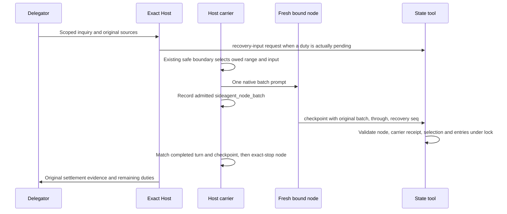

# Carrier-native recovery checkpoint path — #428

Status: Expert design ready for Host review; **not implemented by this run**.
Authority: `owner-kw-carrier-recovery-expert-20261030`, Owner via Delegator Jennie.
Run: `issue-428`, branch `workflow/issue-428`; canonical root
`/Users/ylpromax5/Workspace/kaola-project-runner-dev`.
Implementation handoff: [#429](https://github.com/KaolaBrother/kaola-project-runner/issues/429)
(OPEN, not claimed by this run). No self-finalize.

## 1. Finding and current evidence

Retain the existing native carrier path. Make its original sent receipt mandatory for
**every** maintenance checkpoint, including ordinary business-only checkpoints. Do not
create another dispatcher, recovery queue, ledger, timer, batch importer or force-ack.
Host/Delegator direct sends can communicate a question; they cannot create a
checkpointable batch. A syntactically plausible or recomputed `b-*` id is not proof.

Source baseline is KPR `671c821f` (v0.9.35 pin P, content R
`303956e91e49a26b645784798f5e6ab147adb8fb`). The following are independent facts:

| Evidence | Observed result and limit |
| --- | --- |
| KW `.kaola/sideagent-recovery-check-20261030.json` | Earlier captured node turn reports refused `batch-unverified`, through 99, acked/handled 23/23, recovery#1 open. It is a truncated historical capture, not current state. Its recommendation to repair/reopen #421 is superseded by this #428 mandate. |
| KW `.kaola/heartbeat-prompt.json`, read 2026-10-30 01:24:36 UTC | Revision 117, host_revision 99; acked/handled **99/99**; `last_checkpoint.batch=b-0ea3020f0abb`, verified=true, `recovery#1` settled, no pending `recovery_input`, no alerts. `recovery_seq=1` remains as a monotonic counter; its presence does **not** mean open recovery. |
| Original Host log, locator H below | 13392 started node; **13393 sent native batch** with recovery input seq 1; 13394 settled verified through 99; 13399 exact-stop receipt `stopped:true`. |
| Host/node records | Host `73701bf2b2cba2d34d44efe10d925cd7`, node `37b8b7bc9ee4644e41062771a3231ef0`; node dispatcher points to that Host. Both accepted revision R. Node state stopped. |
| Node prompt and checkpoint | Native batch fingerprint `sha256:50a7a235aac13ef98ed5ba7e73c2a5584789379b15714267dbf820a25be37b11` matches node `last_prompt` and `turn_ended` cursor 645. Checkpoint recovery input equals the sent input object, holder and through match. |

KW is `/Users/ylpromax5/Workspace/Kaola-Workflow` (the supplied lowercase path
resolves to that checkout on this machine). Original locators:

- H: `/tmp/kaola-501/zcode/zcode-KW-orchestrator-main/eb70a2cc6e423931/events.jsonl`
- Host record: same directory, `record.json`.
- N: `/tmp/kaola-501/dsh/dsh-KW-sideagent/eb70a2cc6e423931/record.json`;
  its sibling `events.jsonl` contains the node turn end.
- Heartbeat bytes at that observation: SHA-256
  `b19939b27c02fe5802f391ab4a625265633cdde0a0275b2552c385f93eac5f0b`.
- Checkpoint timestamp: `2026-10-30T01:18:18.173353+00:00`.

These are read-only observations of another operator's successful native run, not
recovery executed by this Expert. A restart receipt alone did not prove settlement;
the separate batch/checkpoint/stop chain does. Current JSON and `/tmp` receipts are
mutable/ephemeral: re-read before acting and preserve necessary redacted engineering
evidence through the normal implementation report/Git, not routine state history.
`last_prompt.source=delegator` occurs even on this legitimate carrier send: source
labels, prompt headers and hash-shaped ids alone must never decide provenance.

### Remaining mechanism gap, reproduced

At this baseline, `scripts/kaola-dispatch.py::apply_checkpoint` calls
`recovery_batch` only when `--recovery-seq` or a `recovery#...` entry is present
(around lines 10590–10623). A bound node can omit both and use an invented batch id
for an ordinary checkpoint. An isolated temporary consumer using the real state CLI
accepted `b-selfprune-recovery-20261030`, returned `written`, and stored
`verified:true`, acked/handled=2/2 without any original carrier event. Its pending
recovery#1 remained open. This is **not** a demonstration that the existing recovery
validator accepts a forged recovery checkpoint; it is a route around that validator
which can mislead maintenance readers and advance business accounting.

`scripts/kaola-recovery-routes.py` currently sends `batch-unverified` and
`node-identity-required` toward generic init/migrate/update/retire instructions.
Those operations cannot repair missing original batch provenance. Recovery scope
errors also incorrectly describe a notice-delivery failure. Correct these bounded
entries; no general routing framework is needed.

### Closed adjacent work remains the baseline

Read current forge bodies/comments and the corresponding
`kaola-workflow/archive/issue-{421,425,426,427}/finalization-summary.md`.

- [#421](https://github.com/KaolaBrother/kaola-project-runner/issues/421), sink
  `19529c91`: cleanup gate, failed binding recovery, coalescing and source-backed
  retire compatibility. Its closure does not certify every consumer recovery.
- [#425](https://github.com/KaolaBrother/kaola-project-runner/issues/425), `f5d4c3cb`:
  P1 terminal deletion, bounded strings, disposition integrity; do not weaken them.
- [#426](https://github.com/KaolaBrother/kaola-project-runner/issues/426), `94d70828`:
  gone-from-live/collect/refs-unindexed retire routes.
- [#427](https://github.com/KaolaBrother/kaola-project-runner/issues/427), `46629e47`:
  actual collect receipt binding and superseded/handed-off settlement.

All four are CLOSED. Reuse their unaffected evidence, never reopen them to stand in
for #428. #421's archived summary explicitly also contains
`final_validation_unverified` for its absent final-validation file; its prose and
closure are not substitutes for the original focused test/live receipts.

## 2. Ownership and the only legal path



1. **Delegator** supplies goal/authorization/source corrections to the existing
   Host. It neither starts a competing maintenance node nor writes checkpoint.
2. **Exact Host** may register a bounded inquiry using the existing
   `state recovery-input --kind request`. Completed Host compaction is registered
   by its carrier from the verified original signal. Neither action is a business
   edit; neither is an acknowledgment. Do not manufacture a Host write to wake it.
3. **Host carrier** alone selects and emits a real maintenance batch in
   `_node_relay_pass` at the ended Host turn/existing idle boundary. It starts the
   fresh bound node through its recorded Runner argument list, selects pending
   business work and/or recovery, sends `_node_prompt`, then records
   `sideagent_node_batch` only for the admitted send. Current predicate is no send
   error, `outcome=in_progress`, and a prompt fingerprint. A queued/unadmitted
   attempt is not such a receipt. The node must not independently start/send itself.
4. **Bound node inside its own session** reads original scoped sources and calls
   `state checkpoint --writer sideagent`. Inherited identity is checked against
   its original Runner record; `--writer sideagent` alone grants no identity.
5. **State tool** owns atomic validation/write, not semantic acceptance. **Carrier**
   checks its matching node turn ended, its batch/holder/through and recovery were
   covered, reports partial/failure or changed attention, and exact-stops the node.
   Host owns result judgment, repair and acceptance; Sideagent owns none of these.

Ordinary worker events still go to the Host. Standalone Runner send/start/read/stop
remain available; this design changes checkpoint evidence admission, not transport
authorization. No new global classifier, heartbeat cadence or Host registry.

## 3. Binding contract and minimal implementation

### Reuse existing fields and original stores

| Fact | Authoritative source | Required relationship |
| --- | --- | --- |
| Caller node | Inherited caller identity + node `record.json` | canonical repo, platform/session, live record's `holder_instance_id`, Sideagent role and current binding match |
| Carrier | Node record `dispatcher` + Host `record.json` | same canonical repo, Host role, exact Host holder |
| Sent batch | Carrier original `events.jsonl` and existing rotations | kind `sideagent_node_batch`; batch, target_holder, host_holder and host_revision_through match caller/command |
| Selected recovery | Event `recovery_input` and `recovery_alerts` | exact selected seq/input; related alert may settle only if selected and still unchanged; newer/unrelated duty stays |
| Selected business work | Carrier's sent revision range, existing `host_changes` semantics | current selected inputs through the receipt's bound through; later rewrites belong to a later batch; deleted rows require no tombstone |
| Sent prompt | Event `prompt_fingerprint`, original node prompt/turn receipts | same admitted turn; source labels are not identity; carrier settlement checks the matching ended turn |
| Checkpoint | `maintenance.last_checkpoint` | batch, node.session/holder, host_revision.from/through/current, recovery.seq/input, checked/unavailable, settled/returned/superseded, source and at |

The existing checkpoint does not duplicate Host holder/fingerprint: batch + node
link back to the original receipt, which supplies those facts. `source` is a locator,
not proof. `host_revision.from` currently means handled at write time, not a newly
invented immutable input snapshot. Business selection remains range-based under
the existing current-record/supersession model; no second list of historical tasks
or business bodies is added. Recovery selection is the exact sent input object.

Implement in the existing modules, in this order:

1. Factor the original event lookup in `recovery_batch` into a common maintenance
   receipt validator called **unconditionally** by `apply_checkpoint`, after
   identity/basic argument validation and before accounting or persistent writes.
   Validate node→Host→original event and match its `prompt_fingerprint` to the
   caller node's original current prompt receipt. Copying an earlier native batch
   id into a later direct-send turn is not that batch's execution. An ordinary event with `recovery_input:null`
   is legal. A sweep-only batch is not a maintenance checkpoint batch: its separate
   proof remains `last_sweep`; do not accept a matching sweep id here.
2. Bind `through` to the sent event, not caller choice. Keep actual state range
   validation (`handled <= through <= current`). A caller cannot turn a sent
   recovery-only batch into coverage for a newer business range.
3. Derive recovery requirements **from the event**. If it carries recovery#N,
   require the matching `--recovery-seq N`; absence/wrong seq is `batch-unverified`.
   Require an entry accounting for N; omission produces `unaccounted`/partial,
   never a verified ordinary-only checkpoint. If no recovery was sent, supplied
   recovery flags/entries cannot manufacture one. Selected unchanged related
   recovery alerts keep their separate scoped entries.
4. Keep scoped entry validation and current-record handling, but constrain extra
   ids to the actual batch. Caller-provided `--events` is not a source of original
   selection. In node maintenance mode worker events are not batch inputs: reject
   an unsupported event id as `batch-unverified` before it can settle anything.
   Preserve the existing bounded superseded/removed-record behavior; an arbitrary
   absent task id outside the sent business range must not gain proof merely from
   `already_settled_input`. Do not re-add retired rows to make this check pass.
5. Hard refusal leaves heartbeat bytes/revisions/ack/handled/recovery/alerts
   unchanged. A validly identified **partial** checkpoint is a written accounting
   result, `verified:false`, with named returned inputs; it is not a hard refusal.
   `handled` can reach the processed range while `acked` remains behind. Never
   present handled alone or last_verified alone as full settlement. Keep N+1,
   unrelated alerts and exact-stop obligations intact.
6. Keep carrier settlement at `_settle_node_events`: matching batch and node,
   covered range, recovery input equality and settled id, completed matching turn.
   A checkpoint write alone does not prove exact-stop or Host adoption. A quiet
   successful batch may have `host_woken:false`, as this KW run did.
7. Correct only the relevant recovery-route messages and canonical references
   (`sideagent-node.md`, `duty-reconcile.md`, plus Delegator guidance if it currently
   encourages direct maintenance dispatch), then regenerate Skills. No manual
   generated-file edit, retroactive event writer or event-import tool.

No new CLI recovery verb, event store or state-schema migration is required for
this design. Existing genuine ordinary receipts already contain the carrier/node/
through fields. Existing successful recovery checkpoints stay historical evidence;
do not invalidate or re-stamp them just because this validator is tightened.
Fixtures that previously fabricated ordinary batch names must exercise the real
carrier send path or explicitly represent a negative case. Do not weaken tests to
preserve the demonstrated bypass.

Upgrade boundary: consume a matching installed state tool and holder bundle. An
already valid old sent receipt remains usable under the above fields. A legacy
receipt missing required provenance is unverified, with the duty intact; no guessed
backfill. Existing `carrier_supported:false` is a capability observation, not
settlement. Runtime adoption/restart needs the normal separate authorization;
v0.9.35 restart already completed is not a grant for future upgrades. Test old valid
receipt/new validator and already-running node continuity before declaring support.

## 4. Stable refusal and partial-result contract

Preserve the existing top-level reason vocabulary. Test `reason` and structured
state effects, not the whole English sentence. Earlier wrapper checks can win:
for example an identified Host claiming writer=sideagent is `writer-refused`, while
writer=host reaching checkpoint is `node-identity-required`. Do not promise every
bad call reaches the same inner guard.

| Reason | Trigger / meaning | Recovery and regression point |
| --- | --- | --- |
| `node-identity-required` | Missing own node identity, or checkpoint writer not sideagent | Run inside the actual bound node; never export a fabricated dispatcher env. No-identity fixture refuses with identical state bytes. |
| `writer-refused` / `writer-mismatch` | Original role conflicts with requested writer / bound Sideagent tries Host role | Correct role through its owner; never use a writer flag to impersonate another role. Test wrapper precedence. |
| `sideagent-unbound` | No applicable active/replacing binding | Host reconciles binding and holds through existing commands; no automatic enabling. |
| `binding-superseded` | Another session/holder now owns the binding, or old node record no longer matches | Old node writes nothing; exact owner reconciles the live node. Test replacement and delayed checkpoint. |
| `identity-unavailable` | Required original node/Host record cannot be read | Keep duty open; inspect recorded location/root/version. Do not reconstruct identity from prose. |
| `identity-mismatch` | Original record names a different holder | Keep duty; read replacement's original receipts, never transplant the old event. |
| `batch-unverified` | No original bound Host; absent native event; wrong batch/Host/node/through/current prompt fingerprint; sweep event used as maintenance; missing/wrong selected recovery seq; recovery entry/event id not sent | Read original carrier receipt, reconcile effects and use the native bounded request path. Never init/migrate/retire to manufacture proof. Include exact missing relationship in detail. Test all dimensions independently and direct fake batch with and without recovery flags. |
| `invalid-input` | Invalid JSON/types, entry without input id, through outside current handled..current range | Correct syntax/range from original batch and current view; no invented range. State unchanged on refusal. |
| `source-required` | Missing nonempty source locator | Cite the actual batch/original source, not a new batch label. |
| `host-identity-required` | Recovery registration attempted outside exact Host | Delegator requests the Host; a node cannot register itself as Host. |
| `signal-unverified` | Claimed compaction lacks original completed, same-session HOST signal | Inquiry fallback through Host; no fake signal or worker-compaction substitution. |

Schema/version/size/lock failures retain the existing state-tool contracts; this
change does not collapse them into provenance errors or authorize clearing state.
If sources or an original send cannot be verified, uncertainty stays explicit.

Entry-level diagnostics are **partial result reasons**, not necessarily exit 2:

| Diagnostic | Trigger / required test |
| --- | --- |
| `recovery-entry-unknown` | Recovery entry has a disallowed key, including retained/returned; retain existing allowed input/checked/unavailable/applied vocabulary. |
| `recovery-scopes-missing` | Scope union is not exactly authorization, duties, links. |
| `recovery-scope-conflict` | A scope appears in both checked and unavailable. |
| `recovery-sources-empty` | Checked scope has empty/non-list/non-string references. |
| `recovery-unavailable-unreadable` | Unavailable reason is empty/non-string. |
| `recovery-originals-unavailable` | One or more scoped originals cannot be read; do not claim fully checked. |
| `entry-needs-one-verb`, `returned-unreadable`, `entry-needs-applied-or-retained` | Conflicting verbs, invalid returned text, or neither/both applied and retained. |
| `applied-empty`, `applied-unreadable`, record/retirement detail | Invalid applied refs or refs not written by this holder/currently removed under the existing rules. |
| retained-record detail | No current record/section or responsible next reader. |
| `not-in-batch`, `unaccounted` | An id was not selected, or a required selected input was omitted. |

`entry-unreadable` becomes hard `invalid-input` when no input id can be extracted.
Host-owned standing-input normalization is existing behavior: test it separately,
and do not misrepresent it as checking unavailable recovery sources. Diagnostic
precedence follows `checkpoint_entry` (shape, scopes, refs, availability, verb).
`missing_sources` is the existing coarse projection of these diagnostics; preserve
the original reason/locator in checkpoint evidence. Carrier `checkpoint-partial`
and `checkpoint-missing` describe outcomes it saw, not alternative authorization to
settle. `old-node-live`/unconfirmed stop requires exact-holder reconciliation first.

## 5. KW recovery#1 executable runbook

**Current branch A is already satisfied. Do not execute a new request for #1.**
The commands below are for the owning KW Host/node under their own effective
authorization; this design seat did not run any mutating KW command. Paths must be
reconfirmed from that Host's current binding/record before later use.

### A. Read and join existing proof first

Inside the exact KW Host, these are current installed paths observed in its binding:

```bash
kw_root=/Users/ylpromax5/Workspace/Kaola-Workflow
kw_state="$kw_root/.kaola/heartbeat-prompt.json"
kw_tool=/Users/ylpromax5/.zcode/skills/kaola-project-runner/scripts/kaola-dispatch.py
python3 "$kw_tool" state view --file "$kw_state" --role host
python3 "$kw_tool" state view --file "$kw_state" --role sideagent
```

Read the current Host/node records and original events, including rotations if
present. Confirm canonical repo, actual loaded accepted_revision, binding mode,
session and holder. Join event batch/node/Host/through/recovery object and prompt
fingerprint to the checkpoint and ended node turn. Require recovery#1 settled,
its `recovery_input` absent, no applicable unresolved returned/stop duty, plus
carrier exact-stop. Preserve an unrelated newer recovery if it appeared.

At the observed revision the answer is: **already legally settled**, through 99,
batch `b-0ea3020f0abb`; reuse it. Report that proof to Jennie via Host. The old
`b-ec0d38cf56d3` @23 had `recovery_input:null`; it cannot be reused for recovery#1.
No reset, new seq, fake batch, tombstone or ledger edit is needed.

### B. If re-reading an unresolved occurrence, native re-offer only

1. Inspect pending input, returned alerts, current binding, original last attempt,
   and exact node state. If a matching batch is active/admitted, observe that batch;
   do not replay an unknown mutation or direct-send to its node.
2. For an **unsent** existing recovery input with an active usable node binding and
   no unresolved old-node stop, end the current Host turn and allow the **existing**
   carrier boundary to select it. No CLI `sideagent-node send` exists to invoke here.
   `_node_recovery_pending` selects the unsent input; `_node_relay_pass` sends it.
   For original KW #1 this has now happened with successor Host 73701bf2; restarting
   again to clear in-memory markers is not the recovery API.
3. A returned failed attempt is intentionally not blindly replayed. Host first
   reconciles original effects and proves the exact old node stopped, and repairs
   only an authorized broken binding. With #1 retained as an actual unresolved
   `maintenance-returned.inputs["recovery#1"]`, issue **one** bounded request with
   its original failure/event locator, from inside the Host:

   ```bash
   python3 "$kw_tool" state recovery-input --file "$kw_state" --kind request \
     --source 'Host bounded carrier recovery after original attempt reconciliation' \
     --evidence '<actual original failure/event locator for the unresolved duty>'
   ```

   Replace the locator with evidence actually read, not this placeholder. The
   result may be `unchanged` for the same request; do not loop to invent a new id.
   A genuinely new request may create seq 2: that is a new reconciliation input,
   **not** a claim that #1 was solved. Native receipt carries the unchanged #1
   alert in `recovery_alerts`; the node must check #1 separately alongside seq 2.
   If #1 is neither pending-unsent nor retained in such an original current alert,
   or the same request is still suppressed, stop recovery mutation and hand that
   concrete gap to Host/implementation. Do not overwrite the only duty, insert a
   counterfeit failure row, change binding just to wake, or delete `recovery_sent`.
4. At the next safe boundary observe `sideagent_node_started` and then a real
   `sideagent_node_batch`. Read B, N, R and target holder from that event. An
   `in_progress` connection is not a failed attempt; no batch event means no
   checkpointable dispatch. Respect explicit auth/quota refusals. For a transient
   service failure use existing safe retries only after prior effects are known
   (at least three safe retries after initial failure before declaring persistent
   failure); if unsafe, report uncertainty and the original recovery path.
5. In **that fresh node only**, read the three source scopes and selected business
   ids. The carrier-generated command is authoritative:

   ```bash
   python3 "$kw_tool" state checkpoint --file "$kw_state" --writer sideagent \
     --source "$B" --batch "$B" --through-host-revision "$R" \
     --recovery-seq "$N" --entries @/absolute/path/to/this-node-checked-entries.json
   ```

   B/N/R are values of the actual native batch, not caller-chosen ids. The entries
   file contains only this batch's real checked/retained/applied/unavailable inputs.
   For original seq1: input `recovery#1`, checked authorization/duties/links with
   nonempty original locators. Ordinary selected sections at the observed R99
   were authorization@89, project@97, sideagent@99; re-read, never hard-code them.
   Source task ids are references, not new selected inputs. A newer request must
   separately account for the unchanged selected #1 alert if it is to settle it.
6. Read the actual checkpoint result and carrier settlement/stop chain, then re-read
   heartbeat. Full recovery requires exact scoped coverage and no applicable
   unresolved duty. On partial/refusal leave the duty and report the precise reason;
   do not rerun with recovery flags removed. Do not remove unrelated or stop rows.

### C. Owner decision boundary, not an adopted escape hatch

No discard/force-release rule is needed or adopted for the now-proven KW #1 result.
If later asked to cancel an unverifiable duty, waive source requirements, treat an
issue close as recovery settlement, widen to cross-repo behavior changes, or install/
restart without current authority, output **HUMAN_DECISION_REQUIRED** with the exact
unresolved input, evidence, proposed scope and alternatives. Stop that dependent
action and return via Host to Delegator Jennie. Until Owner decides, keep it open.
Even an Owner cancellation must not be called a verified checkpoint or retroactive
carrier send. Its representation would need an explicit scoped design decision;
this document adds no cancellation mechanism. No such decision is pending merely
to deliver this design.

## 6. Prevent forge/runtime divergence

Use the existing Host/Delegator heartbeat and forge comments, not a second status
database. At the existing acceptance/closeout boundary join these independent facts:

| Side | Read / establish |
| --- | --- |
| Forge | Exact issue, latest corrections, final candidate and test evidence; CLOSED means that issue's accepted scope, not a consumer receipt. |
| Runtime | Actual installed and loaded revision, pending recovery input/returned duties, latest scoped checkpoint + native event/node match, exact-stop. Counter equality alone is insufficient. |
| Cross-reference | Existing #428/paired implementation comment cites the runtime chain and its time; existing current Host duty names the unresolved implementation/consumer acceptance only while it is real. |

For #428 design readiness, report the four checklist rows honestly (below); do not
tick implementation regression PASS because KW has recovered once. Host may accept
the design and then direct its normal finalize. Paired implementation remains OPEN
until the code/tests/adoption and authorized consumer acceptance are evidenced.
If source implementation is complete but an applicable consumer duty still cannot
settle, keep an explicit open acceptance duty/issue with owner and next action;
never report the combined runtime outcome complete. Do not silently use #421 CLOSED
as proof or reopen it. A newer runtime duty after acceptance is evaluated as new work
against its original evidence, not confused with the covered seq1.

Host and Delegator derive their concise heartbeat report from the same current
collections and original links. When genuinely resolved, remove only the current
duty by its normal typed route; no resolved rows, authorization history, moved
tombstones, seat ledger or copied requirement archive. Normal engineering evidence
and necessary historical reproduction facts remain in Git/docs and forge comments.

## 7. Implementation test plan and this run's verification

Use isolated temporary repositories/record roots. Synthetic records belong only to
fixtures; never inject them into real Runner records. Reuse
`tests/contract/test-issue-255-lifecycle-state.py`'s `MaintenanceCheckpoint` and
`HolderNodeMode` fixtures. Add bounded cases in the existing suite or a focused
inventory suite if that gives materially smaller feedback; no new test framework.

| Case | Required result |
| --- | --- |
| Direct fake recovery batch, valid node and sources | `batch-unverified`; byte-identical state. |
| Same fake id **without** recovery flag/entry, including empty entries and fabricated --events | Refused; never verified, no ack/handled/recovery movement. This is the reproduced missing regression. |
| Fake id calculated with the native hash formula; copied prompt header | Still refused without original sent event; no backfill route. |
| Real ordinary carrier batch (null recovery), real combined batch, real recovery-only batch | Successful scoped accounting and matching carrier settlement/stop; existing transport unaffected. |
| Real recovery receipt, flag omitted/wrong seq/extra recovery id | Refused; omission cannot downgrade the batch to business-only. Missing required entry with correct flag is partial/unaccounted. |
| Batch/Host/node/repo/through or current prompt fingerprint mismatch, sweep id, replaced node, absent original records | Stable reason by table; state unchanged. Test node-to-carrier linkage independently from readable source refs; a direct later turn cannot reuse an earlier native id. |
| Each scope/entry diagnostic above | Correct hard-versus-partial result; missing originals remain owed; no false verified. |
| Host rewrites/deletes a selected record during node turn; newer recovery N+1 | Existing supersession/retirement behavior, only selected range accounted; N+1 and unrelated/stop duties preserved. |
| Failed batch + native request with unchanged recovery alert | Fresh native receipt carries old duty and failed business range; original check settles only selected matching rows; no fake business write. |
| No business change + genuine recovery request; repeated request; busy Host boundary | One compatible batch through existing boundary; no second scheduler/node or direct send; no mistaken failure for in-progress. |
| Admitted send vs unadmitted/failed send; partial/missing checkpoint; lost/unconfirmed-stop node | No phantom batch proof, visible duty, exact-stop ownership; retain existing safe recovery/fallback limits. |
| Old valid native receipt with new tool; preserved pending input across supported upgrade | Compatibility preserved without re-stamping history or erasing duties; unsupported provenance is explicit. |
| Forge CLOSED with runtime still open (fixture), and counter=1 with no pending input (KW shape) | First cannot be called combined completion; second is not a false unresolved alarm. No forge write in fixture. |
| Relevant route strings | `batch-unverified` points to native carrier recovery, identity error to own node, scope errors to originals; no init/retire/backfill advice. |

Focused implementation gates (repeat only for changed/invalidated coverage):

```bash
./scripts/render-skills.py --write
./scripts/render-skills.py --check
./scripts/validate.sh --suite test-issue-255-lifecycle-state.py \
  --suite test-issue-292-state-record-root.py \
  --suite test-issue-412-maintenance-owed-retire.py \
  --suite test-issue-309-recovery-routes.py
```

If the implementation touches shared writer/retirement code, also run the affected
#421/#425/#426/#427 inventories; otherwise reuse their unchanged results with exact
scope, not new PASS claims. Required live integration is an authorized affected
Host/node start→send→read→checkpoint→stop with genuine receipts; this design dispatch
does not authorize that experiment. No Cursor/cursor-cli or Fable. No unnecessary
whole-inventory/platform rerun. Holder changes require release restart disclosure
under the existing operator test and platform pin rules.

**Executed in this design run on baseline 671c821f:** three existing temporary-fixture
tests passed in 1.865 s (no live session):

- `MaintenanceCheckpoint.test_a_checkpoint_needs_the_nodes_own_identity_and_a_valid_range`
- `MaintenanceCheckpoint.test_recovery_checkpoint_binds_sent_input_batch_and_holder_keeps_newer`
- `MaintenanceCheckpoint.test_recovery_unavailable_sources_stay_visible_and_scoped_clear_keeps_other_alerts`

Also executed the real-CLI ordinary-bypass probe described in §1, using the same
fixture: init, node bind, recovery_request, node identity with **no carrier batch**,
entries retaining current pending sections, checkpoint with fake B and no recovery
flag. It returned exit 0/written/verified:true, kept recovery#1 pending. This is a
confirmed baseline defect, **not a fix PASS**. The fixture cleaned its temp directory.
No production tests/code added, no consumer state or shared checkout changed.

Read-only live joins in §1 passed; the proposed complete regression matrix and new
integrated candidate have **NOT RUN** because implementation belongs to the next
Worker. Documentation local links/map and whitespace checks passed. The design
worktree's `render-skills.py --check` exits **1** at the release pin guard:
`P may differ from 303956e91e49 only by ...; found docs/README.md`.
No source/generated bytes changed (`git diff --exit-code HEAD -- scripts templates
skills hosts platforms tests` passed). This design is not a new release pin candidate;
changing pin metadata would exceed its docs-only boundary. Report the guard result
as a limitation, not a generated-check PASS; the later implementation/release must
use the normal content/pin convention. The unchanged main checkout at 671c821f
passed the same render check (12 workers, orchestrator, Delegator and Grok Bot bridge;
pin/budgets OK), localizing this failure to the docs delta under the P guard.
No full inventory or live activation was run.

## 8. Checklist and documentation impact

| #428 acceptance | Design handoff result |
| --- | --- |
| Expert implementable design / paired issue | This document, bounded source changes, ownership, test plan and paired issue; ready for Host judgment. |
| Skill/Runner path and stable refusal | §§2–4, current versus proposed behavior explicit; source and three focused baseline tests verified. |
| KW seq1 re-walk/settle or Owner rule | §5 executable conditional runbook; current original native chain already proves seq1 settled through 99. No discard rule adopted, no duplicate re-walk. |
| Direct batch cannot become checkpoint evidence | Negative regression specified and ordinary bypass reproduced; **implementation/fix validation pending**, not passed by this design. |

Documentation map: [docs/README.md](README.md) links this design. This run changes
only this document and that index on the Workflow run branch, in addition to the
explicitly authorized main-checkout claim/mission ledger. `doc-impact: design-only`;
no current runtime/API behavior or release note is claimed changed. Follow-up
implementation docks the operative contract in canonical Skill references, API and
recovery messages, renders generated outputs and records CHANGELOG restart impact.
Preserve `templates/grok-golden/` byte-for-byte. KW and shared
`/Users/ylpromax5/Workspace/kaola-project-runner` remain read-only in this dispatch.

Forge writes for this run are only #428 progress comments and its one paired
implementation issue. Do not close #428, edit its checklist/body/labels, publish,
merge, archive or self-finalize before Host acceptance and separate instruction.
